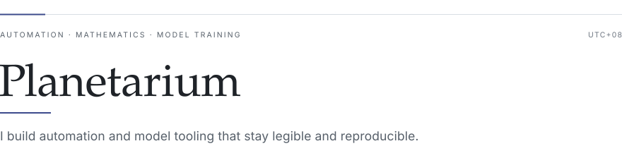
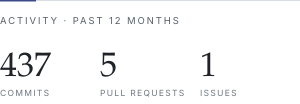
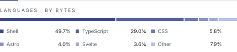

<picture>
  <source media="(prefers-color-scheme: dark)" srcset="assets/hero-dark.svg">
  
</picture>

## About

I write Python, C and C++, mostly for automation and tooling around models.

Recent work is in agent workflows and evaluation, with some applied mathematics
and model training alongside. My environments are declarative and reproducible,
which in practice means NixOS.

## Focus

- **Automation** — agent workflows, tooling, evaluation.
- **Mathematics** — applied and discrete mathematics.
- **Models** — training and fine-tuning.
- **Environments** — NixOS, Linux, declarative configuration.

## Stack

<code>Python</code> · <code>C</code> · <code>C++</code> · <code>Nix</code> · <code>Shell</code> · <code>Lua</code>
 
Learning Rust and Zig · NixOS (current) · Arch Linux (previously) · macOS

## At a glance

  <picture>
    <source media="(prefers-color-scheme: dark)" srcset="https://raw.githubusercontent.com/planetarium1001/planetarium1001/cards/card-activity-dark.svg">
    
  </picture>
  <picture>
    <source media="(prefers-color-scheme: dark)" srcset="https://raw.githubusercontent.com/planetarium1001/planetarium1001/cards/card-languages-dark.svg">
    
  </picture>

Regenerated every six hours from the GitHub API, and published to the <code>cards</code> branch.

   
  E L S E W H E R E
    
  <a href="https://planetarium1001.com">Blog</a> &nbsp;·&nbsp;
  <a href="mailto:me@planetarium1001.com">Email</a> &nbsp;·&nbsp;
  <a href="https://github.com/planetarium1001">GitHub</a>

